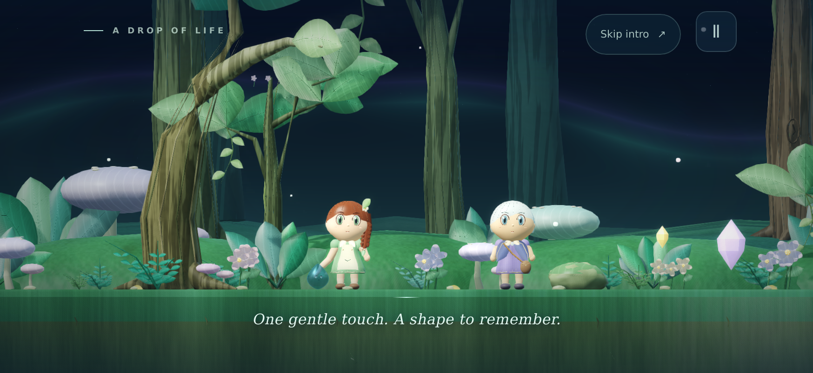
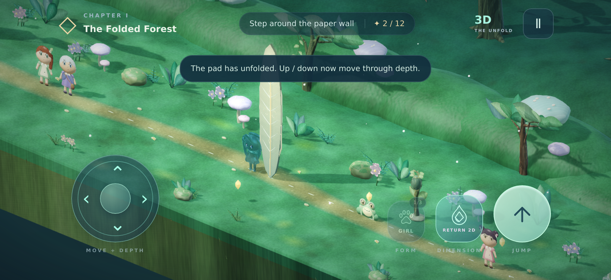

# Enter the Third Dimension

A landscape iPhone adventure about a raindrop that remembers the lives it
touches. A drop falls from a tree into a mystical rainforest. After a girl's
gentle touch, it gathers into a human shape. Later, touching a moss frog and a
forest fox teaches it their forms too. The water character, living creatures,
and rainforest all use smooth original geometry and shading.

Walk and jump through the forest, then use a prism to reveal its third
dimension. The girl floats, gathers into a drop, and reforms with volume as
the world turns. The other inhabitants and magical leaf barriers stay flat. Explore the
depth axis to walk around obstacles and find a bridge hidden behind the road.

This release contains **Chapter I: The Folded Forest**, a complete short
introductory chapter with a lost-light quest, checkpoints, twelve collectible
shards, and a concluding story beat.

## A first look

These are actual frames from the bundled game running in WebKit at a landscape
iPhone viewport. The native Simulator capture and launch evidence are attached
to the GitHub release.





## Controls

| Action | iPhone | Keyboard |
| --- | --- | --- |
| Move along the road | Left/right pad | Left/right arrows or A/D |
| Jump | Right jump button; hold for height | Space; hold for height |
| Enter or leave 3D | Glowing drop, after finding the prism | E or Shift |
| Change remembered form | Form button, after touching another creature | Q |
| Move through depth in 3D | Unfolded thumbstick, up/down | Up/down arrows or W/S |
| Pause | Upper-right pause button | Escape or P |

The left/right axis continues to follow the road when the camera turns.
Up/down moves away from or toward the viewer along the depth axis. Touch
movement and jumping use independent pointers, and sliding the movement
thumb updates its direction continuously. Losing focus clears held controls.

The power can be used on solid ground. Returning to 2D checks the entire depth
segment and verifies a supporting surface on the flat plane. A blocked return
produces a brief hint without moving the player into a wall or over a gap.

## Presentation and runtime

- Sculpted water girl, frog, and fox forms with pearly reflections, translucent
  scene refraction, thickness absorption, subtle caustic filaments, and moving
  internal bubbles. The girl has shaped cheeks, layered bangs and flowing
  locks; the frog has crouched haunches and toes; the fox has four paws, a
  muzzle, ears, and a brush tail.
- Expressive chibi inhabitants with layered irises, corneal highlights,
  blinking eyelids, distinct hairstyles, detailed outfits, and gentle
  breathing, head, hair, and clothing motion.
- An opening sequence showing the raindrop falling from a tree and learning
  a human shape through contact. Floating drop-to-creature morphs accompany
  dimensional shifts and changes between remembered forms, with tapering
  light ribbons and a closer camera during the transformation.
- A real XYZ scene, depth-buffered geometry, an animated orthographic camera,
  and a player with depth. The wall and hidden-bridge puzzles remain.
- A layered rainforest with curved trunks and roots, moving broad leaves,
  moss, ferns, flowers, luminous mushrooms, lanterns, and a warm earth path.
- Soft dynamic cast shadows for the world, inhabitants, and the current
  deformed water shape; per-fragment materials distinguish skin, hair,
  fabric, wet foliage, bark, stone, and the ground.
- Quarter-resolution Gaussian bloom, restrained light shafts, smoother edges,
  and a ripple centered on the transforming character. Rendering uses up to
  2× device pixel ratio in full effects and 1.25× in reduced effects, with
  spatial scenery culling. See [graphics and licensing](docs/GRAPHICS-LICENSE.md).
- Offline bundled HTML/CSS/JavaScript in a native UIKit/WKWebView host. No
  accounts, analytics, remote assets, runtime downloads, or game dependencies.
- Fixed 120 Hz simulation, coyote time, jump buffering, variable jump height,
  automatic lantern checkpoints, and local chapter progress.
- Full/reduced effects and sound settings. System Reduce Motion initializes
  the effects preference on first launch.
- Safe-area-aware landscape layout, native lifecycle pause, WebGL context
  restoration, and a native loading screen that waits for a rendered frame.

## Build

Run on macOS with Xcode 26 or later and an installed iPhone simulator:

```sh
./build-macos.sh
```

The build generates a normal Xcode project from `Support/build_project.py`,
compiles with Apple's Foundation/UIKit/WebKit headers, launches the actual
bundled app in the simulator, and requires a successful JavaScript/WebGL
readiness report before packaging the arm64 device application. That report
must also prove that the current water material, dynamic shadows, bloom,
and edge smoothing initialized and rendered without a graphics error.

Outputs are under `Build/`: `EnterTheThirdDimension.ipa`, a source archive,
checksums, and native build evidence. The GitHub workflow publishes them and
updates the repository's app catalog from the verified public IPA.

The current distribution package is ad-hoc signed for a sideloading workflow.
For App Store distribution, build/archive with the appropriate Apple team,
bundle registration and distribution signing. That submission is separate
from this GitHub release. The stable bundle identifier remains
`com.billy.moonhop`; app version is **2.2**, build **4**, deployment target
**iOS 16.0**.

## Source map

- `Sources/main.m`: real-SDK native app and window lifecycle.
- `Resources/Game/world.js`: world geometry, quest positions, and collectibles.
- `Resources/Game/game.js`: gameplay, collisions, input, progress, and audio.
- `Resources/Game/render.js`: world renderer, camera, geometry and postprocessing.
- `Resources/Game/rainforest.js`: rainforest geometry and original chibi inhabitants.
- `Resources/Game/visuals.js`: original material lighting, shadows, and finishing shaders.
- `Resources/Game/water.js`: smooth water character and its original material.
- `Resources/Game/art.js`: legacy pixel sprite definitions, retained for compatibility.
- `Resources/Game/index.html`, `style.css`: interface and touch controls.
- `Support/`: project generation, build verification, and release publication.

`window.ThirdDimension.getState()` provides read-only diagnostic snapshots.
It does not expose teleportation or mutable game state. The retained
`window.Moonhop.nativePause()` alias supports the working native lifecycle.
