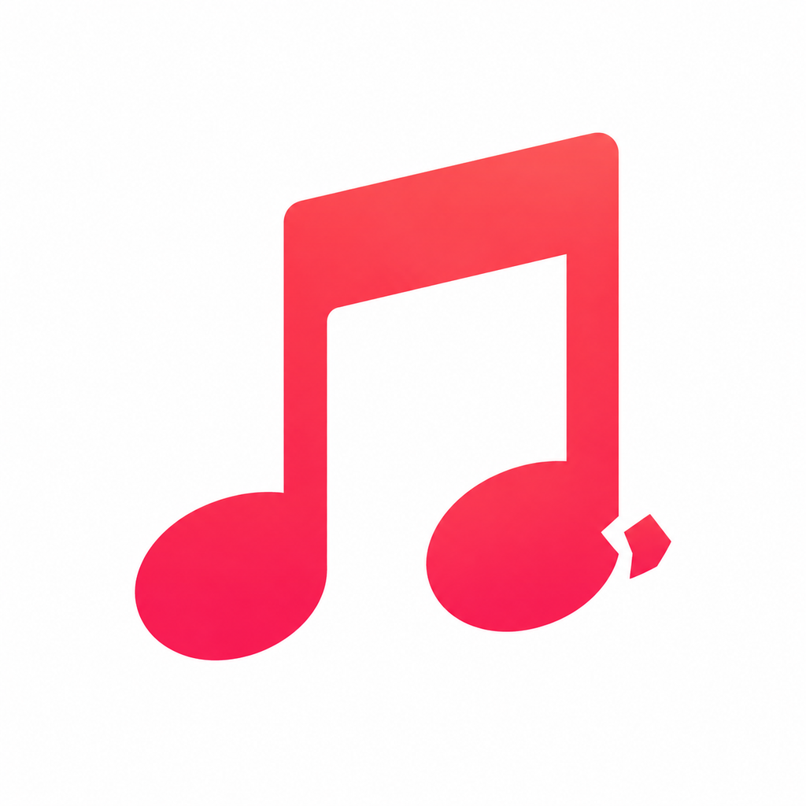
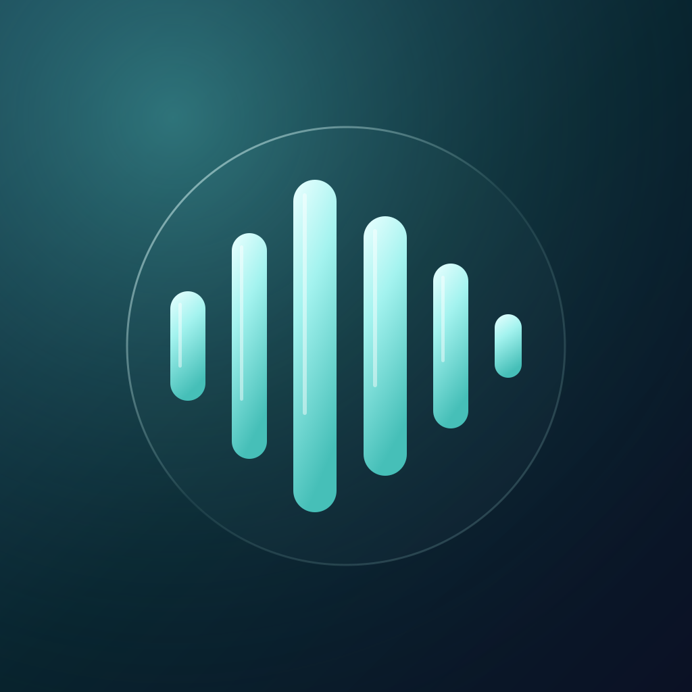
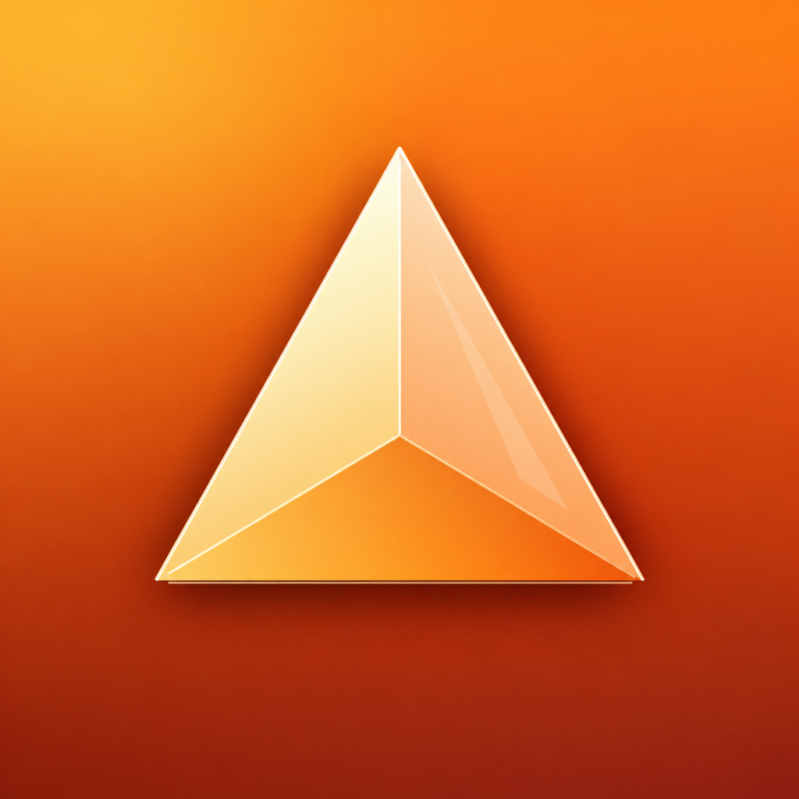

# Strezzy’s iPhone Apps

Your apps, together in one place. Local music, voice creation, image creation, and a little moonlit adventure.

## Add to LiveContainer

In **LiveContainer → Sources → +**, paste:

```text
https://raw.githubusercontent.com/Strezzy/ios-apps/main/apps.json
```

Refresh this source to see new versions, then tap Install for the app you want.
For an existing app, update its existing entry and keep its current data container.
Export important creations before changing installations; an in-place update on your phone has not been validated for every app.

## Downloads

| App | Version | Download | Requires |
| --- | --- | --- | --- |
|  **Music** — Your music. Offline. | 0.10 (11) | [Download IPA](https://github.com/Strezzy/ios-apps/releases/download/initial-apps/Music.ipa) | iOS 16.0+ |
|  **VoiceGlass** — Create with your voice. On your iPhone. | 1.0 (1) | [Download IPA](https://github.com/Strezzy/ios-apps/releases/download/initial-apps/VoiceGlass.ipa) | iOS 26.0+ |
|  **Prism** — Your imagination. On your iPhone. | 1.0 (1) | [Download IPA](https://github.com/Strezzy/ios-apps/releases/download/initial-apps/Prism.ipa) | iOS 26.0+ |
|  **Moonhop** — A little moonlit adventure. | 1.0 (1) | [Download IPA](https://github.com/Strezzy/ios-apps/releases/download/initial-apps/Moonhop.ipa) | iOS 16.0+ |

IPAs are device builds for a signing/sideloading installer or LiveContainer. They are not App Store packages.
VoiceGlass and Prism download model weights separately, then process locally. Physical-iPhone model inference has not yet been validated for these builds.

## Publish an update

1. Build the app and increase its version or build number. Keep the same bundle identifier.
2. [Create a release](https://github.com/Strezzy/ios-apps/releases/new) with a **new tag** and upload one or more `.ipa` files. Write the release notes and publish it as a regular release.
3. **Update app catalog** runs automatically. It reads the IPA’s actual bundle ID, version, minimum iOS, permissions, file size, and SHA-256; updates `apps.json`; and refreshes this page.
4. Refresh the source in LiveContainer. The source URL stays the same.

Draft and prerelease uploads do not enter the catalog. Keep published release assets in place so previous versions remain downloadable. Adding an asset after publication requires rerunning the catalog workflow. Do not replace an existing version’s IPA with different bytes; bump its build number instead.

The workflow also has a manual **Run workflow** option with a release tag. A failure leaves the current published catalog unchanged; check the Actions log, correct the release, and run it again.

## Add a future app

Add its exact bundle ID, name, description, and category to `app-registry.json`, and add its PNG icon to `assets/`. Publish its IPA in a new release; the catalog will add it automatically.

The app catalog and compiled downloads are public. VoiceGlass and Prism’s development repositories remain private. This repository does not store voice recordings, photos, generated work, or model weights.

## Catalog format

[AltStore Classic source documentation](https://faq.altstore.io/developers/make-a-source). Both `buildVersion` (AltStore) and `buildNumber` (LiveContainer) are included for compatibility. Latest versions come first; exact bundle identifiers stay unchanged across updates.
