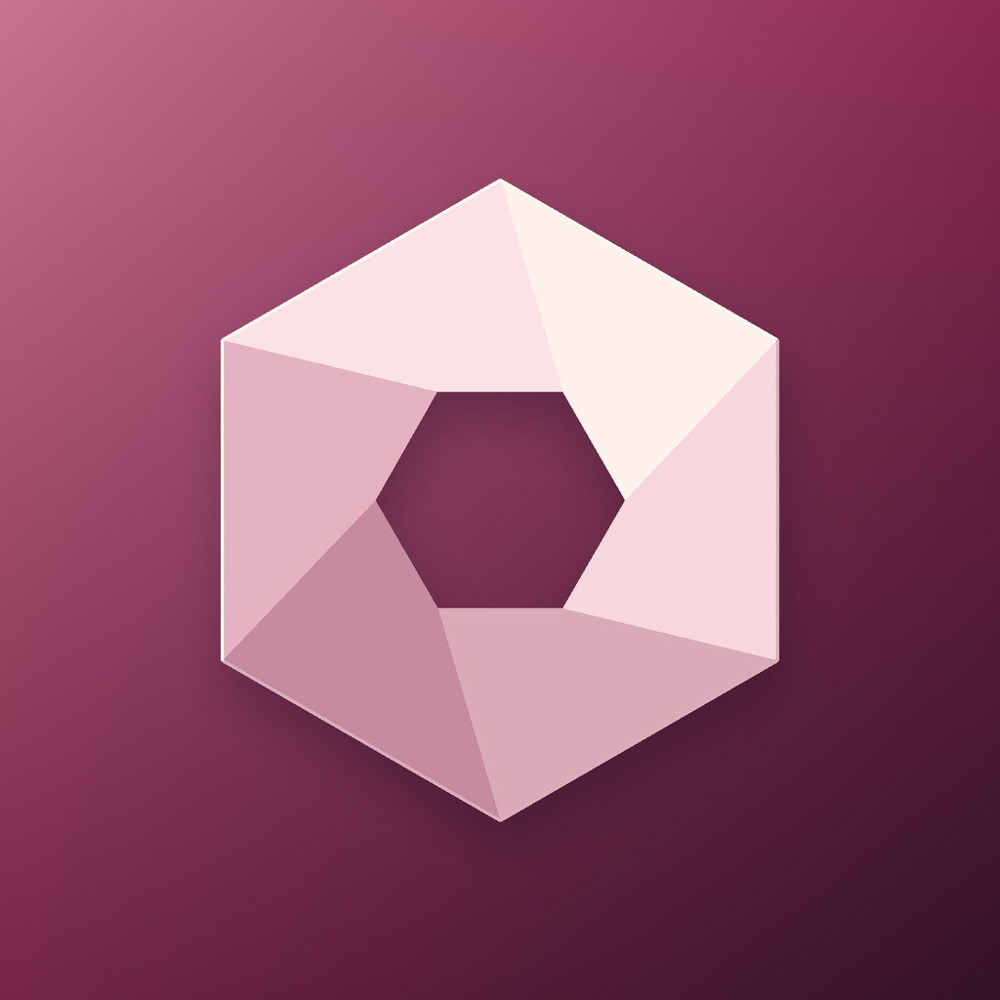

# Velvet

A native SwiftUI camera and encrypted media vault for iPhone. Offline by design, with a bundled multimodal retrieval model and no accounts, analytics, cloud inference or runtime model downloads.



**Early access. Physical iPhone validation is required.** A compiling app and passing simulator tests are not a security certification. Release publishing is gated on the complete iPhone build and XCTest suite.

## Download

Use the [GitHub Releases](../../releases) page for an unsigned IPA, source archive, generated Xcode project, build report, test report and SHA-256 checksum. Sign the IPA with your own trusted sideloading setup. Requires iOS 27.0+. This is a standalone native application, not a website or WebView.

## Implemented foundation

- AVFoundation camera preview and original HEIF/JPEG capture, capability-gated RAW + JPEG, physical lens/front camera selection, tap focus, exposure bias, manual ISO/shutter and white-balance gains, flash, timer and grid.
- Real H.264/HEVC SDR recording using encoded in-memory fragmented-MP4 segments. The only app-owned movie writes are authenticated ciphertext. An AVAsset resource loader decrypts bounded byte ranges for AVPlayer.
- Random per-item AES-256-GCM keys wrapped by a random master key protected by Keychain user presence and ThisDeviceOnly access. Encrypted originals, thumbnails, catalogue, notes, search features, video manifest and segments; Complete file protection and backup exclusion.
- Face ID/device passcode authentication, lifecycle concealment/locking, screen-recording concealment, transactional metadata and authenticated catalogue recovery.
- Lazy gallery, photo/video detail, metadata/notes, favorites, albums, multi-select, exact duplicate detection, manual Trash, still-photo import and encrypted backup/restore.
- Bundled Google EmbeddingGemma 2 Text-Vision 440M with in-memory Universal Embedder input. Encrypted vectors plus Vision labels, OCR, colors and visual features. No plaintext SQLite index. Video search currently uses cover frames.
- Native navigation, tab bars, toolbars and Liquid Glass controls. Artwork extends the Facet/Veil/Lucid/Echo faceted app family.

## Build

Toolchain: Xcode 27.1 / iOS 27.1 SDK, iOS 27.0 deployment, Swift 5 language mode with minimal strict concurrency. CI uses GitHub's `xcode-27` arm64 runner and records the actual toolchain in every release. XcodeGen generates the project from `project.yml`.

```sh
brew install xcodegen
python3 scripts/audit.py
bash scripts/build.sh
bash scripts/test.sh
```

The build fetches one pinned 387,710,976-byte model and verifies SHA-256 before bundling. MediaPipe is pinned to commit `50505c8312c7eacb1bd411cecdc4cc9fd08d53cb`. Model/runtime license text ships in the app; see [AI integration](docs/AI.md). No increased-memory entitlement or signing secrets are used. `Build/Velvet-unsigned.ipa` is the signable output; source build downloads need connectivity, installed app features do not.

## Security and limitations

Read the [threat model](docs/THREAT_MODEL.md), [camera capability matrix](docs/CAMERA.md), [AI integration report](docs/AI.md), and [security report](docs/SECURITY_REPORT.md), and [verification procedure](docs/VERIFICATION.md). Screen captures, compromised operating systems, framework-private memory/caches and physical flash erasure cannot be fully controlled. Explicitly selected system Photos/Files assets may be cloud-backed; source Photos media remains in Photos.

Advanced HDR/Dolby Vision, Log/Log 2, ProRes/ProRes RAW, 100/120 fps, Live Photos/depth, external recording, live coaching, video-moment search and plaintext sharing are not enabled. Encryption takes priority over exposing unvalidated professional formats. Do not treat this build as the only copy of irreplaceable media.

## Testing evidence

`Build/TEST-RESULTS.json` and `Build/BUILD-REPORT.json` are produced by the actual CI run and attached to successful releases. A local source audit does not substitute for those results. Physical-device acceptance is **Needs Device Validation** until the checklist is completed on an iPhone.
